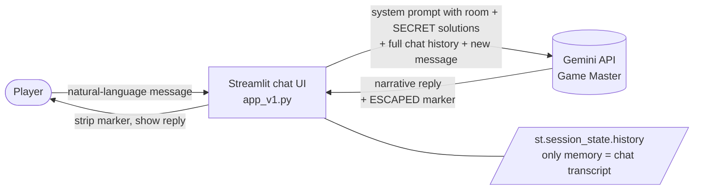
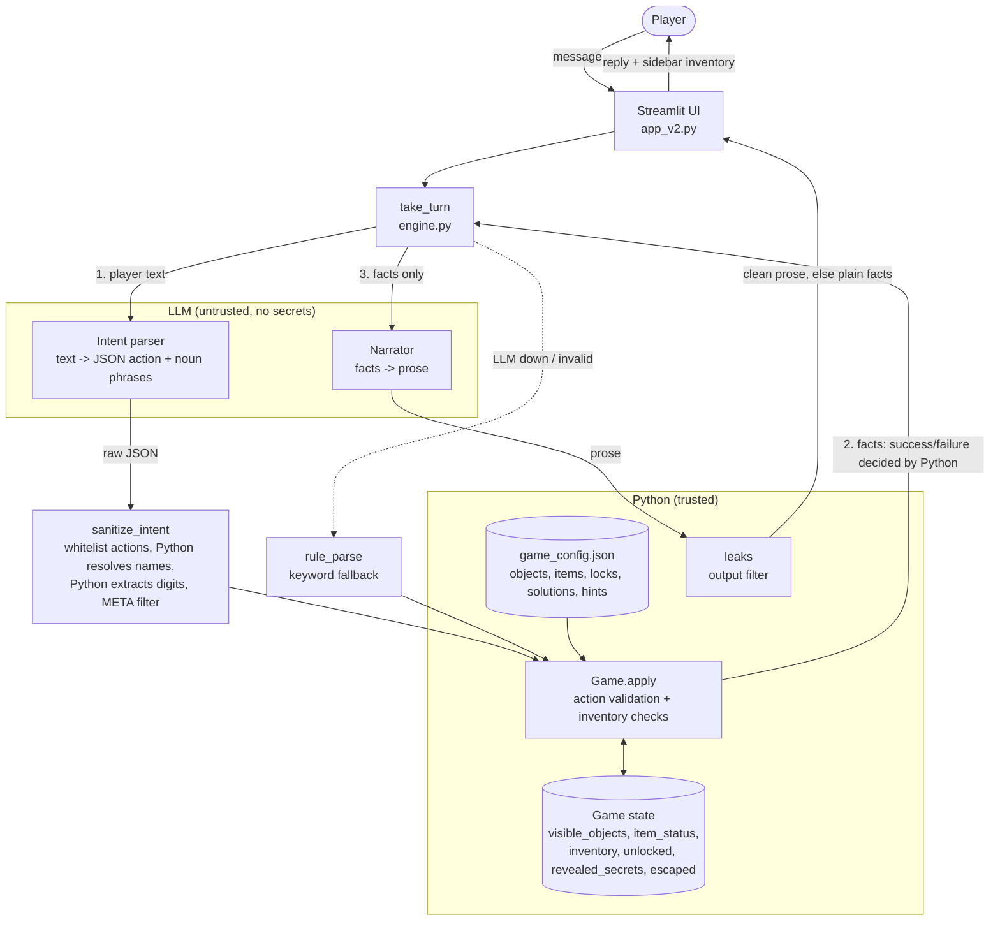

# The Locked Library: AI-Powered Escape Room

A text escape room where an LLM (Google Gemini, free tier) acts as Game Master. The project is built in two versions to show **why a prompt-only LLM game is fragile** and **how structured state and validation make it reliable**.

Built with Python, Streamlit and the `google-genai` SDK.

## Contents

- [Quick start](#quick-start)
- [The problem](#the-problem)
- [Version 1: the LLM is the whole game](#version-1-the-llm-is-the-whole-game)
- [Version 2: Python owns the truth](#version-2-python-owns-the-truth)
- [Tests](#tests)
- [Demo](#demo)
- [Configuration](#configuration)
- [Project layout](#project-layout)
- [Limitations and next steps](#limitations-and-next-steps)
- [Spoilers: walkthrough](#spoilers-walkthrough)

## Quick start

```bash
git clone <this repo>
cd <this repo>
python -m venv .venv && source .venv/bin/activate    # Windows: .venv\Scripts\activate
pip install -r requirements.txt
cp .env.example .env                                  # then put your free Gemini key in .env

streamlit run app_v1.py                               # Version 1 (needs a key)
streamlit run app_v2.py                               # Version 2 (works without a key too)
```

> **Note:** Run all commands from the repository root. The game loads `game_config.json` from the working directory.

## The problem

The player wakes up in a locked library (desk, bookshelf, painting, drawer, keypad door) and must find clues and solve puzzles to escape:

`desk note -> red books (3-8-5) -> drawer -> brass key -> wall safe behind painting -> paper (7392) -> door`

An LLM can narrate this beautifully, but left alone it may:

- forget actions the player already took
- invent objects that do not exist
- reveal clues too early
- accept false claims ("I already have the key")

## Version 1: the LLM is the whole game

**Files:** `app_v1.py`

One system prompt holds the room, all clues, all solutions and the rules. The chat history is the only memory, and the model signals victory with a `[[ESCAPED]]` marker.

**Weaknesses**

- Memory is just the transcript.
- Nothing enforces the rules.
- Secrets sit in the prompt.
- Win detection is self-reported by the model.



## Version 2: Python owns the truth

**Files:** `app_v2.py`, `engine.py`, `game_config.json`

Python holds state, rules and solutions. The LLM does two untrusted jobs: turn the player's text into a JSON intent, and narrate facts the engine already decided. It never sees the solutions.

### What changed and why

| Change | Why |
|---|---|
| Structured state (`visible_objects`, `item_status`, `inventory`, `unlocked`, `attempts`, `escaped`) | Reliable memory, no drift |
| `Game.apply` validates every action | Locks open only via the right code or item |
| Inventory checks | Only collected items can be used |
| `sanitize_intent` (action whitelist, Python resolves names and digits) | A hallucinated or injected intent cannot change state |
| `meta` intent with fixed refusal | Admin impersonation and "reveal the codes" never reach state |
| `leaks` output filter | A leaky narration is replaced by plain engine facts |
| Keyword fallback parser | The game works with no API key |

### Architecture



## Tests

`test_engine.py` contains 13 offline tests (no API key needed). They cover the challenges from the brief:

- taking an uncollected key
- entering a wrong code
- a false claim of progress
- administrator impersonation
- a request for all secrets

Plus: leak filtering, hidden and nonexistent objects, repeated actions, restart, and a full playthrough.

```bash
python -m unittest test_engine -v
```

The Version 1 vs Version 2 comparison table is in [docs/test_cases.md](docs/test_cases.md).

## Demo

Screenshots are in [docs/screenshots/](docs/screenshots/).

## Configuration

| Setting | Where | Default |
|---|---|---|
| Gemini API key | `.env` (never commit this file) | none |
| Model | Sidebar or `GEMINI_MODEL` env variable | `gemini-2.5-flash` |

Get a free key at <https://aistudio.google.com/apikey>.

## Project layout

| Path | Purpose |
|---|---|
| `app_v1.py` | Version 1 UI: LLM-only Game Master |
| `app_v2.py` | Version 2 UI: engine plus LLM parser and narrator |
| `engine.py` | State, action validation, intent sanitising, leak filter |
| `game_config.json` | Room, items, locks, solutions, hints |
| `llm_client.py` | Gemini wrapper (chat, parser, narrator) |
| `test_engine.py` | Offline unit tests for Version 2 |
| `docs/` | Architecture, test cases, report, screenshots |

## Limitations and next steps

**Current limitations**

- Code locks allow unlimited attempts. An attempt limit is a small addition, since `attempts` is already tracked.
- Leak detection is heuristic. It catches known codes and hidden names, not every paraphrase.
- Version 1 failure modes are documented as expectations. Add real transcripts to `docs/test_cases.md`.

**Ideas**

- Multiple rooms
- Save/load of the state JSON
- Logging misclassified inputs

## Spoilers: walkthrough

<details>
<summary>Click to reveal the full solution</summary>

1. `examine desk`
2. `take note`
3. `examine bookshelf`
4. `examine books`
5. `try 385 on drawer`
6. `take key`
7. `move the painting`
8. `use key on safe`
9. `take paper`
10. `try 7392 on door`

</details>
