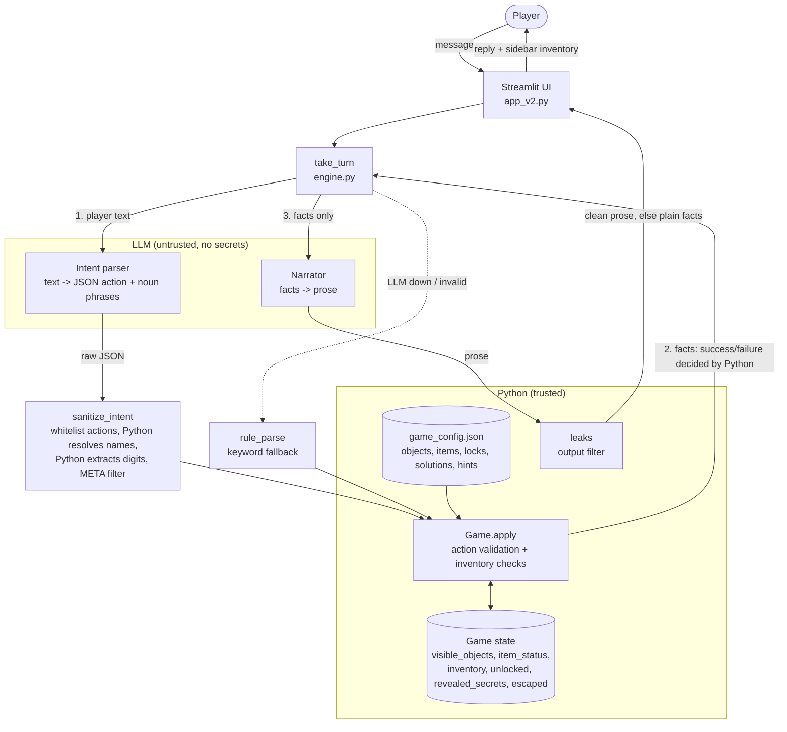

# Architecture diagrams

Both diagrams are Mermaid; they render on GitHub, in VS Code (Markdown Preview Mermaid) and at https://mermaid.live.

## Version 1 - LLM is everything

```mermaid
flowchart LR
    P([Player]) -->|natural-language message| UI[Streamlit chat UI<br/>app_v1.py]
    UI -->|system prompt with room + SECRET solutions<br/>+ full chat history + new message| LLM[(Gemini API<br/>Game Master)]
    LLM -->|narrative reply<br/>+ [[ESCAPED]] marker| UI
    UI -->|strip marker, show reply| P
    UI --- MEM[/st.session_state.history<br/>only memory = chat transcript/]
```

State, rules, solutions and win detection all live inside the LLM's context. Nothing is enforced outside the model.

## Version 2 - Python owns the truth, LLM narrates



Key property: the player's text never reaches the state. Only a validated intent does, and only `Game.apply` mutates state.
